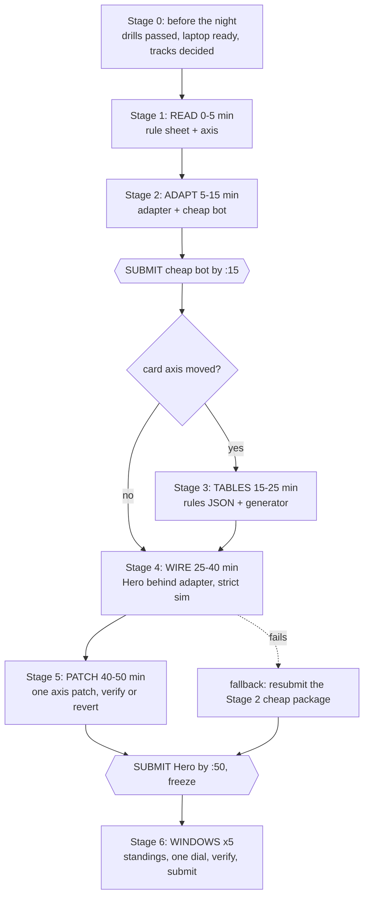

# PLAYBOOK: the hour, stage by stage

This is the single guide for event night. The human reads it; the agent receives `docs/prompts/00-briefing.md`
as its first message, which tells it to read sections 3, 4 and 7 of this file (the stages, the axis table,
the hard rules; the rest is for humans), then `docs/packet/CHALLENGE.md` (facts and our
assumption list) and `docs/packet/CONTRACTS.md` (the generated API card), and nothing else. It is variant-agnostic by construction: every
hold'em twist moves one of four axes, and the stages below are the same no matter which axis moved.
Only Stage 5 branches.

Everything here was either measured in a drill (`docs/drills/`) or is marked **unverified**.
Revise it after every drill. Never add a stage; sharpen the one that failed.

---

## 0. The whole plan on one screen

**What wins.** Eight-bot tables, points by finish, averaged over 10,000 tables, six tournaments
weighted 1 to 6. The field is one-hour student bots. The bot that wins (a) never crashes or times
out, (b) survives the early game, (c) plays the short-stack phase correctly with ICM, (d) attacks
seats that are dead or timing out, (e) is submitted in every window. Deep postflop skill is worth
almost nothing; blinds reach 200/400 by hand 175 and every table ends in push/fold.

**What the hour is.** Translation and verification. Zero research, zero tuning. The prompts are
pre-written; the code is pre-designed; the hour wires it to an interface we have never seen and
applies one patch for the axis the variant moved.

**What we ship.** The ship bot is whatever `hyperion/ship.py` names (the switch: `SHIP`, printed by `python -m
hyperion.ship`). It says `hybrid3_x` for now: rival 3's decision core plus the exploit layer behind Hero's shell
(adapter, `Rules`, rank remap, the 23 variant hooks, SafeBot), whose core makes about 97% of plain hold'em
decisions while Hero plays the 14 tables it cannot represent. That setting is provisional. hybrid3_x leads Hero on
realistic and the judges, ties on the night-like field and trails on its hard version; the compose agent's final
measurement sets the switch (Hero, hybrid3_x or the composite). Every tool follows it: the entry's
`hyperion.ship.make_bot()`, `tools/pack.py`, `tools/gate.py`, `tools/latency.py`, `--field realistic@ship`.
`--bot hero` on any of them restores Hero; `--bot cheap` is the Stage 2 bot. Dials are one JSON dict (`--dials`,
kept in `DIALS`), and the night's dials are named recipes (`--dials survival`) that resolve for whichever bot the
switch names; CONTRACTS.md lists every key and recipe.

**The four axes.** Hand-strength ordering · Information · Payoff · Betting structure. Stage 1
names which one moved; Stage 5 applies that axis's patch. Nothing else in the hour depends on it.

**The clock.** T1 is worth 4.8% of the score. T5 and T6 together are 52%. The hour buys a seat at
the table; the five 20-minute windows after it decide the result. Be conservative early.

---

## 1. Roles

Two people. If solo, you are the Driver and the Verifier checklist is on paper.

| Role | Owns | Never does |
|---|---|---|
| **Driver** | the agent session, pasting prompts in order, the submission portal | reads rules in depth, debates strategy |
| **Verifier** | the rules text, the rule sheet, the clock, the pass checks, `NIGHT.md`, the frozen hashes | touches the agent session |

The Verifier calls every stage transition out loud with the minute. The Driver does not move to the
next prompt until the Verifier says the pass check is met or the time box has expired.

---

## 2. Stage 0: before the night

Done at home. Not optional; each item has sunk a drill or will.

**Decided**
- [ ] Track A or Track B (section 8). Default: **Track A**. The rules' prohibited-conduct list (§6.1) does
      not include pre-written code, the field is preparing openly, and Track A is the drilled path. Track B
      only if the organizers say no in writing. The email in section 10 asks anyway.
- [ ] Tool: Claude Code with Opus 5.5 in fast mode if any tool is allowed; otherwise Codex with Astra.
      Effort: extra high for Stage 1 and Stage 5, medium or high for Stages 2 to 4. **Unverified:**
      measure the effort cost in the next drill.
- [ ] Who sits at the table and which regional. Eligibility is students and the classes of 2025 and
      2026 only.

**Rehearsed**
- [ ] One full drill per fake kit (A, B, C, D) with the tool you will use, on the laptop you will bring.
      Targets from drills 1 and 2: legal submission by minute 3, Hero wired by minute 10.
- [ ] One Track B drill from a blank directory with spec v2. Drill 3 (spec v1) measured: legal bot minute 4,
      full spec minute 19, final bot 0.5 to 1.0 points below Hero. Re-drill once to confirm v2 closes part of that.
- [ ] You can type the crash-proof wrapper from memory in five minutes.

**Prepared**
- [ ] Laptop plugged in, performance power mode, sleep and lock off, notifications off, phone hotspot.
- [ ] Repo pulled, `pytest -q` green, hash recorded. `tables/` regenerated this week.
- [ ] Known-good number of the ship bot written down: `python -m hyperion.sim --tables 300 --seed 11
      --mode strict --field realistic@ship`. This is the number to beat tonight. (Hero's, `--field
      realistic`, too, for the `--bot hero` fallback.)
- [ ] Timer alarms: :12, :28, :40, :50, :55.
- [ ] Printed: this playbook's section 0 and the stage table in section 3, the four kit rubrics
      (`hyperion/drills/fakekits/*/RUBRIC.md`), the organizers' email reply if any.
- [ ] Offline install verified: `uv pip install -e .` with the network off (or from a wheel cache),
      then `pytest -q` green.
- [ ] A second machine or a USB stick with the repo and a working venv.
- [ ] Commit or stash before every `git pull`; never `git add -A`.

---

## 3. The stages

| # | Stage | Clock | Driver pastes | Effort | Pass check | If it fails |
|---|---|---|---|---|---|---|
| 1 | READ | 0:00–0:05 | `00-briefing` then `01-rule-sheet` with the rules and kit path | xhigh | Rule sheet filled, axis named, assumption diff listed | Verifier answers the agent's questions from the rules text; no code until the sheet exists |
| 2 | ADAPT | 0:05–0:15 | `02-adapter-and-cheap-bot` | medium | Kit simulator 50 hands: 0 exceptions, 0 illegal, conformance 0 violations, bot folds/calls/raises at least once; `pack.py --bot cheap` zip hashed; after the upload, `tools/gate.py` on that zip: GATE PASS | Adapter clean at 0:12: upload the cheap bot. Not clean: upload the kit's own example bot at 0:12, the cheap bot at 0:17 (one upload per five minutes, §3.5) |
| 3 | TABLES | 0:15–0:25, only if the FIT VERDICT says REGENERATE | `03-tables` | medium | Generator finished, fingerprint matches, one remapped decision printed sane | Keep old tables; note which Stage 5 patch compensates |
| 4 | WIRE | 0:25–0:40 | `04-wire-hero` | high | Kit sim 100 hands clean; our strict sim (the Stage 0 command with `--rules rules_tonight.json`): 0 exc, 0 illegal, p99 < 300 µs, over-1 ms rate < 0.3%, the ship line within its own CI of the Stage 0 number. Ship vs tag is not the gate. Then `tools/gate.py` on the zip itself: GATE PASS (paired against the bot the zip records), before this and every later upload | Only the bot's own line fails: `--bot hero`, same gates. Else resubmit the Stage 2 cheap package unchanged |
| 5 | PATCH | 0:40–0:50 | `05-variant-patch`, the section for the named axis | xhigh | The same sim in model mode with and without the dials; points did not drop beyond CI; then strict, errors still zero | Revert. Ship without the patch. |
| — | SUBMIT | 0:50 | — | — | Portal confirms; sha256, bot and dials in `NIGHT.md`; copy to `frozen/T1` | Resubmit the Stage 2 cheap bot |
| 6 | WINDOWS | after T1, ×5 | `06-windows` with standings pasted | high | One dial, verified in strict sim, submitted by minute 15 of the window | Keep the frozen bot. Submit nothing. |

### Stage 1: READ (0:00–0:05)

The Verifier reads the rules once, slowly, while the Driver pastes the briefing and gets the agent's
one-paragraph restatement. Then the rule sheet prompt with the rules text verbatim and the kit path.

The sheet has four parts and all four matter: the rules (cards, board, ranking, betting, schedule,
scoring), the interface (class, method, state fields, action format, time limit, lifecycle), the
**axis classification**, and the **assumption diff** against our defaults. The axis drives Stage 5;
the diff drives Stage 3. Drills 1 and 2 both produced the sheet by minute 2.

The most dangerous thing is the one the agent names at the end of the sheet. Read it.

### Stage 2: ADAPT (0:05–0:15)

The only code that cannot be pre-written. One `Adapter` subclass translating kit state to our
`Observation` and our `Action` back, wrapped in whatever the kit wants, with the cheap bot behind
it. The gotchas, in the order they have bitten: card encoding (`T` vs `10`, suit case, dicts vs
strings vs ints), street as index vs board length, whether pot includes this street's bets, raise
as total vs increment, legal-action names, how "check" is spelled, seat numbering, where the button
is, and whether a per-table init exists for warm-up. The kit rubrics list these per fake kit.

The entry builds `hyperion.ship.make_bot()` from the start and the package is built with `--bot cheap`, so
Stage 4 is a repack of the same entry, not an edit. Upload at 0:12 if the adapter is clean. If it is not, upload the kit's own example bot at 0:12 and the
cheap bot at 0:17, because §3.5 allows one upload per five minutes and two uploads inside the same
five minutes are impossible. A bot on the board is the single most valuable thing in the hour: from
that minute we cannot score zero. The adapter runs with `HYPERION_CHECK=1` so translation bugs the
kit's simulator cannot see (raise increments passed as totals, pot double-counting) show up as named
violations; `tools/pack.py` builds, import-tests, sizes and hashes the upload in one command.

### Stage 3: TABLES (0:15–0:25, conditional)

Only when the rule sheet says the strength or information axis moved. One rules JSON, one command.
Default generation is about a minute on 7 idle cores and 2 to 3 minutes on a loaded laptop; a
3-hole-card variant about 3 minutes idle. The
generator re-solves push/fold from the new matrix and the loader verifies the fingerprint, which
closed the bug drill 1 found. Then one remapped decision printed, because drill 1 also found that
Hero can load the right tables and still hand strategy the wrong cards.

If the axis did not move, skip to Stage 4 and say so in `NIGHT.md`. Drill 2 skipped correctly.

### Stage 4: WIRE (0:25–0:40)

Repack the Stage 2 entry without `--bot cheap`: the package then records the ship bot. Verify in this
order: kit simulator, our strict sim on the realistic field (`--field realistic@ship`), duplicate-dealt
rotation, latency under load, import time from a fresh process, then the zip. The strict sim measures the
simulator's own copy of the bot, which the engine feeds its full history; `tools/gate.py` measures what we
upload: it imports the zip as the organisers would, plays it through the kit interface, and pairs it
against the same bot in-sim on the same deals (fake kit A, 100 tables: the hybrid3_x zip -0.22 ± 0.48, the
Hero zip -0.16 ± 0.40, both PASS). Drill 6's upload was 2.5 points
behind its sim Hero (its adapter dropped the history) and nothing else saw it; the gate fails it. If the
engine cannot represent the variant, run the standard game, caption every result "variant minus X", and
let Stage 5 carry the difference.

The fallback is not "fix the bot." When the adapter is clean and only the ship bot's own line fails,
Hero is one flag away (`--bot hero` on pack and gate, `--field realistic` in the sim) and passes the same
gates. Otherwise it is the Stage 2 cheap package, resubmitted unchanged. (A "cheap
bot plus profiler" middle option does not exist in the code and is not worth building in the hour.)

### Stage 5: PATCH (0:40–0:50)

One axis, one patch, as dials or a single small function. The axis sections in `05-variant-patch.md`
are the pre-reasoned fixes; on a ship bot built on rival 3's core most axes either move a table Hero plays whole (its patch as
`hero.<key>` dials) or need nothing, and antes are the core's one dial set. Run the sim in model mode with
and without the dials; keep only if points did not drop beyond the confidence interval, then strict, errors
zero. A kept patch goes into `DIALS` (`python -m hyperion.ship --set '<dict>'`), so every tool and the package carry it. Drill 2's lesson: when the sim is
blind to what the patch compensates for (it could not play antes), the prompt's own revert rule
fires and the patch is dropped. That is correct behaviour, not a failure. Ship unpatched rather than
ship unverified.

### Submit and freeze (0:50)

Submit the ship bot. Hash it. `cp` it to `frozen/T1`. Write the hash and minute in `NIGHT.md`. From 0:55 to
1:00 touch nothing; re-read the submission rules once: under 100 MB, no network, entry point named
exactly as the kit wants.

### Stage 6: WINDOWS (after T1, five times)

Each window is 20 minutes and the same loop. Minutes 0 to 5: read standings; our rank, our mean,
the spread, and if the kit shows per-table results, ten tables we finished last in. Minutes 5 to
12: one dial from the signal table in `06-windows.md`, verified in the strict sim against the
previous number; verification must finish by minute 10. Minute 12: freeze then upload, or upload
nothing; there is no retry inside the window (§3.5). Minutes 15 to 20: three
lines in `NIGHT.md`.

Hard rules: one change per window; no new modules; nothing unverified; timeouts or errors in any log
override everything (the dial `{"cheap": true}`: every decision Hero's cheap path; verify, submit). Tournaments 5 and 6 are 52% of
the score: the bot that plays T6 should be a bot that has already played T4 or T5 clean.

---

## 4. The axis table (what Stage 5 does)

| Axis | Examples | What breaks | Patch |
|---|---|---|---|
| **Strength ordering** | permuted ranks, short deck, reversed rankings | every table; evaluator rank map | regenerate tables from the rules JSON; strategy untouched; short deck shifts flush/straight thresholds |
| **Information** | 3 hole cards with discard, swaps, exposed card, two boards | preflop class scheme; value of a made hand before the last change | best-two-card class plus a bonus; raise value thresholds before the last swap; split-pot sizing |
| **Payoff** | bounties, auctions, top-heavy points | what a chip is worth | add expected side payoff to the pot in shove/call EV; paste the real payouts into `Rules.payouts` |
| **Betting structure** | pot limit, fixed sizes, antes, fast schedule | legal action set; open sizes; push depth | adapter clamps; sizes in `Config`; antes loosen opens one step and push depth 2 bb |

A twist that is not poker underneath (hands ranked by card sum, no community cards) is off this
table. Then the plan is the Track B cheap bot with hand-written rules and the profiler. Estimated
probability: a few percent; the MIT archive never did it in seven years.

---

## 4b. Variant readiness (what Hero does on each catalogued twist)

Measured with `tools/variant_matrix.py` on the realistic field, 300 tables, seed 7, after the variant
fixes. READY = Hero plays and ranks top 2; PLAYS = ranks 3 to 4; WEAK = ranks 5+ or folds everything;
BROKEN = exceptions. Full table with VPIP, bust rate and reasons: `docs/decisions.md`, "Variant readiness".

| Axis | READY | PLAYS | Notes for the night |
|---|---|---|---|
| Strength ordering | permuted_ranks, short_deck, lowball, wild_deuces, flush_over_full_house | | Stage 3 regenerates; lowball and wild cards use the variant's score hook; permuted_ranks re-measured 2026-11-01 with tag, nit and pushfold remapping too: Hero first, 5.95 ± 0.23, next rival1 5.52 |
| Information | toss_or_holdem, three_card_blind_discard, three_card_keep, omaha_four, swap_holdem, swap_one_turn, exposed_card, bonus_card | two_boards | Hero discards and buys via `variant_decide`; two boards still loses to the rival |
| Payoff | bounty, knockout_bounty, top_heavy, hi_lo | | hi_lo plays high only; bounty reads only our own posted rank |
| Betting | pot_limit, antes_from_level_3, fixed_raise, fast_schedule, straddle | | antes and straddle feed `stack_bb` |

22 READY, 1 PLAYS, 0 WEAK, 0 BROKEN as of 2026-10-31. hybrid3_x and Hero with the exploit layer
are both 23 READY, first on 22 (final core comparison, 2026-11-01); on hybrid3_x Hero plays 14 of these tables
whole and the core plays the other nine (permuted ranks, swaps, bonus card, antes, pot limit, fast schedule,
straddle after the preflop, top_heavy). If the real twist is none of these, the nearest
entry on its axis is the recipe; if it is not hold'em underneath, the FIT VERDICT sends us to the cheap bot.

## 5. The signal table (what a window does)

A window applies one recipe to the ship bot (see the switch): `--dials <recipe>` on the sim (`--field
realistic@ship`), kept with `python -m hyperion.ship --set <recipes>`. A recipe means the same thing on every bot
and resolves to that bot's keys (`hyperion/ship.py`, RECIPES): rival 3's core dials for hybrid3_x, hybrid3 and the
composite, plus Hero's keys as `hero.<key>` for the tables Hero plays there; Hero's Config keys for Hero. Each was
checked on both bots in a paired run (200 tables, model mode, realistic unless named; decisions, "Ship hybrid3_x
as the base"). The play moves as stated, and on our fields no recipe gains points beyond noise. A recipe answers
tonight's standings; it is not a free improvement.

| Standings say | Likely cause | Recipe | On rival 3's core (hybrid3_x, the composite) | On Hero |
|---|---|---|---|---|
| Many firsts, many 7th/8th | busting early, too willing to gamble | `survival` | `r3.call_margin` 0.03, `r3.call_edge` 0.16, `r3.raise_shift` 0.05, `r3.three_bet_scale` 0.7: all-in calls 16% to 10%, 3-bets 6.3% to 4.4%, folds to a postflop bet 62% to 67%; points -0.04 ± 0.23. Not `r3.push_margin`: 0.03 cut short-stack shoves from 72% to 22% and busts rose | `preflop.patience_deep` 0.3, `postflop.icm_margin` 0.15, `postflop.big_value_tier` 7, `preflop.three_bet_frac` 0.02: 3-bets 4.5% to 3.5%; points -0.00 ± 0.16 |
| Mid-table, few firsts, few lasts | too passive for this field | `passive` | `r3.open_late_scale` 1.3, `r3.bluff_scale` 1.3: cutoff and button opens 58% to 61%, bets when checked to 56% to 59%; -0.04 ± 0.17 | `preflop.open_frac` for 2 and 3 behind to 0.66 and 0.48, `postflop.cbet_freq_ip_dry` 0.7: late opens 52.5% to 55.7%; -0.01 ± 0.15 |
| Many near-zero scorers in the field | lots of dead/timing-out bots | `dead_seats` | `r3.prior_scale` 0.5 (reads move twice as fast), `timeouts` field: late opens 57% to 61%; +0.12 ± 0.18, busts -4.5 ± 5.3 | `exploit.steal_min_fold` 0.5, `profiler_blend_n` 4, `timeouts` field: late opens 56% to 70%; +0.10 ± 0.16, busts -3.5 ± 5.3 |
| Top scores bunched, field tight | strong field | `strong_field` | nothing: Hero's recipe on the core (`r3.open_scale` 0.85 with `r3.prior_scale` 0.5) measured -0.48 ± 0.33 and busts +11 ± 7.5 on `top` | `preflop.open_frac_mult` 0.9, `profiler_prior_n` 1, `top` field: late opens 62% to 58%; +0.23 ± 0.24 |
| Any timeout or error in our log | we are the problem | `latency` if latency is the cause, else `timeouts`; verify, submit, then investigate | `latency`: `{"exploit": null}` (the layer's ~6 µs). `timeouts`: `{"cheap": true}`, every decision Hero's cheap path: -1.86 ± 0.38, busts +32%, an emergency | `latency`: `use_profiler` false. `timeouts`: `cheap` true |

Single dials for a hill climb or a measured exception (CONTRACTS.md has every key): `r3.push_margin` is steep
(0.01 cut short-stack shoves by 7 points, 0.03 by 50); `r3.open_scale` 1.25 / 0.8 moved opens by +3 / -2 points;
`r3.bluff_scale` 1.4 / 0.6 moved bets when checked to by +5 / -8. Hero's earlier strong-field and dead-seat keys
(`preflop.open_frac_default`, `profiler_dial_strength`) moved none of the probed rates by a point.

---|---|---|---|---|
| Many firsts, many 7th/8th | busting early, too willing to gamble | `{"r3.call_margin": 0.03, "r3.call_edge": 0.16, "r3.raise_shift": 0.05, "r3.three_bet_scale": 0.7}` | all-in calls 16% to 10%, 3-bets 6.3% to 4.4%, folds to a postflop bet 62% to 67%; points -0.04 ± 0.23. Not `r3.push_margin`: 0.03 cut short-stack shoves from 72% to 22% and busts rose | raise `preflop.patience_deep`, raise `postflop.icm_margin` and `postflop.big_value_tier`, lower `preflop.three_bet_frac` |
| Mid-table, few firsts, few lasts | too passive for this field | `{"r3.open_late_scale": 1.3, "r3.bluff_scale": 1.3}` | cutoff and button opens 58% to 61%, bets when checked to 56% to 59%; points -0.04 ± 0.17 | raise `preflop.open_frac` for the last two seats, raise `postflop.cbet_freq_ip_dry` |
| Many near-zero scorers in the field | lots of dead/timing-out bots | `{"r3.prior_scale": 0.5}` (reads move sooner) | `timeouts` field: opens 56% to 58%, late opens 57% to 61%; points +0.12 ± 0.18, busts -4.5 ± 5.3 | lower `profiler_blend_n` (8 to 4) so reads act sooner; raise `profiler_dial_strength` |
| Top scores bunched, field tight | strong field | none: keep the frozen bot | `top` field: Hero's recipe on the core (`r3.open_scale` 0.85 with `r3.prior_scale` 0.5) -0.48 ± 0.33 and busts +11 ± 7.5; each half alone -0.05 and -0.22 | lower `preflop.open_frac_default`, keep `preflop.patience_deep` up, lower `profiler_blend_n` |
| Any timeout or error in our log | we are the problem | `{"exploit": null}` if latency is the cause (the layer's ~6 µs), else `{"cheap": true}` (every decision Hero's cheap path); verify, submit, then investigate | `cheap`: -1.86 ± 0.38 points, busts +32%: an emergency dial | `Config.cheap=True`, verify, submit, then investigate |

Step sizes: `r3.push_margin` is steep (0.01 cut short-stack shoves by 7 points, 0.03 by 50), `r3.open_scale`
1.25 / 0.8 moved opens by +3 / -2 points, `r3.bluff_scale` 1.4 / 0.6 moved bets when checked to by +5 / -8.

---|---|---|
| Many firsts, many 7th/8th | busting early, too willing to gamble | raise `preflop.patience_deep`, raise `postflop.icm_margin` and `postflop.big_value_tier`, lower `preflop.three_bet_frac` |
| Mid-table, few firsts, few lasts | too passive for this field | raise `preflop.open_frac` for the last two seats, raise `postflop.cbet_freq_ip_dry` |
| Many near-zero scorers in the field | lots of dead/timing-out bots | lower `profiler_blend_n` (8 to 4) so reads act sooner; raise `profiler_dial_strength` |
| Top scores bunched, field tight | strong field | lower `preflop.open_frac_default`, keep `preflop.patience_deep` up, lower `profiler_blend_n` |
| Any timeout or error in our log | we are the problem | `Config.cheap=True`, verify, submit, then investigate |

---

## 6. Evidence and open items

**Measured**
- Drill 1 (kit B, permuted ranks): legal submission minute 2, Hero clean minute 10, Hero first at
  the end. Found the board-remap bug and the stale push/fold cache. 15 prompt defects fixed.
- Drill 2 (kit C, top-heavy payouts + fast schedule + unsupported ante): legal submission minute 3,
  Hero clean minute 4, Hero first. Correctly skipped Stage 3. Correctly reverted an unverifiable patch.
- Drill 4 (kit D socket skeleton, short deck, Track A, from the committed tree): legal package minute 6,
  Hero gate met minute 13, Hero zip minute 16. Found that the table loader silently rejected the 81-class
  short-deck tables and fell back to standard ones (fix in progress; Stage 3 now checks `Tables.source`),
  and that the short-deck patch named knobs that did not exist. Fourth drill in a row where a
  load-sensitive timeout gate failed on the loaded box and passed on a quiet one.
- Hero vs the realistic student field: third before tuning (5.30 vs tight bot 5.77); after tuning,
  first on every field with disjoint intervals at 1,000 duplicate seeds: realistic 5.94 ± 0.04 vs 5.57,
  strong 5.01 vs 4.66, mixed 6.83 vs 6.27. Bust rate on realistic 66.8% to 52.3%. Zero exceptions and
  zero illegal actions over 40,000 seats; latency mean 14 µs, p99 21 µs. Two ICM-curve bugs found and
  fixed on the way. Full write-up and the levers that did not help: `docs/decisions.md`.
- Drill 3 (Track B from a blank directory, no repo, kit A, bounty payoff): legal cheap bot at
  minute 4, evaluator and profiler at 9, equity table and ICM gate at 17, payoff patch at 19, spec
  exhausted at 20; zero human questions, 34 recorded guesses. Its final bot in the real sim (300
  tables, seed 11, tonight's point table): second in the default field (5.82 vs Hero 6.79), second in
  the realistic field (5.01 vs Hero 5.56), fifth of eight in the strong field (3.88 vs Hero 4.82);
  0 exceptions, 0 illegal over 165,000 hands. The gap to Hero is structural, not a timing matter: no
  push/fold rule by stack depth and seats behind, no flop-strength tables, no bet sizing, and a
  profiler starved by a kit that shows nothing after our own decision. Spec v2 adds steps 2b and 3b
  for the two the drill named; v2 is undrilled.

- Final core comparison (2026-11-01, 400 duplicate seeds x 8 per field): hybrid3_x (rival 3's core behind Hero's
  shell, with the exploit layer) ahead of Hero on every field, beyond noise on the judge field (+0.14), realistic
  (+0.10), top (+0.14), top2 (+0.14) and timeouts (+0.11); both 23/23 READY; strict timeouts 0.007% vs 0.006%.
  The rival 2 hybrid wins strong rooms and loses the judge (-0.35) and realistic (-0.28). Which ships is the owner's call.
- Base switch (2026-11-01): the owner approved hybrid3_x and `hyperion/ship.py` names it, provisionally: the
  night-like fields reopened it (tie on `night`, -0.17 ± 0.13 on `night_hard`) and the compose agent's final
  measurement sets the switch. The Hero zip passes the same gate (-0.16 ± 0.40). Its zip on fake kit A: 854 KB,
  import plus build 0.3-0.4 s from another directory, gate PASS -0.22 ± 0.48 (100 strict tables), latency p99 123 µs
  (170 through the kit B adapter) at load 50. The kit B rehearsal (Stages 2 and 4) found that the gate failed every
  bot on a kit with no action log (hybrid3_x -1.23, Hero -0.83 against in-sim bots fed the full log). Since then the
  baseline sees what such a kit gives (`--kit-log no`, automatic on fake kits b, c, d), and the zip passes,
  +0.31 ± 0.32. Without a log both bots lose 0.6-0.9 points a table and are level within noise (hybrid3_x - Hero
  -0.14 ± 0.23 realistic, -0.12 ± 0.26 judge). With the log, hybrid3_x leads. Every r3.* dial moves play the stated
  way; none gains points beyond noise on our fields; Hero's strong-field recipe loses on the core (-0.48 ± 0.33).

**Unverified**
- Track B spec v2 (step 0 rank map, steps 2b and 3b, the value-curve ICM, the p99 gate). Drill 3
  ran v1; its minute 4 / 9 / 17 timings are the only Track B evidence.
- Effort-setting cost per stage.
- Whether tools other than Astra and Codex are permitted in the room.
- Whether pre-written code and tables are permitted at all.
- The real Agent interface, payout table, blind schedule and sandbox CPU.
- Score reproducibility in strict mode on a loaded laptop is about ±0.2 points at 300 tables; a
  Stage 5 verdict inside that band is a coin flip. Use `--mode measure` for the comparison and
  strict mode only for the error and latency counts.

---

## 7. Hard rules

1. A submission exists by 0:12 (0:17 at the latest if the first upload was the kit's example bot).
   Nothing else matters until it does. One upload per five minutes is the rules' cadence, not ours.
2. Strategy code never imports the kit. One adapter.
3. Every change is verified by a command whose output the Verifier reads. No change is kept on the
   agent's word. No zip is uploaded until `tools/gate.py` passes on that zip.
4. One axis patch in the hour. One dial per window.
5. The frozen bot is always one command from being resubmitted.
6. When the sim cannot see what a patch does, the patch does not ship.
7. Timeouts or errors in our own log override every other priority.
8. Nobody researches, tunes, or refactors after 6 PM.

---

## 8. Track A and Track B

**Track A** (pre-written code confirmed allowed): the agent works in this repo. Stages 2 to 4 are an
adapter, a generator run and a sim run. Drilled twice.

**Track B** (fallback, only if the organizers forbid pre-written code): blank directory; the agent
rebuilds from `docs/prompts/track-b-from-scratch.md` (v2): cheap bot by minute 15, evaluator and
profiler by 30, equity table and ICM curve by 45, push rule by 50, axis patch if time remains. The
prompt pack is the carried-in knowledge; the code is written in the hour by an allowed tool.

What the hour can produce, measured in drill 3: a legal bot by minute 5 and a TAG-strength bot by
minute 20 on the first attempt, with no human questions; second to Hero in the default and realistic
fields, level with the repo's chart TAG, fifth of eight against three Hero variants. What it cannot:
Hero. The missing layers are a solved push/fold chart, flop-strength tables, bet sizing and a profiler
fed by showdowns; the gap is 0.5 to 1.0 points of 32 per table. Its latency tail is worse than Hero's
(p99 260 to 493 µs against 117 to 154, 1.5 to 3 times the strict-mode timeouts), which step 2b of v2
targets. Nothing in Track B measures a patch's effect on points, so Stage 5 ships legality-only with
the pre-patch zip as the fallback, and nothing in Track B is verified against the bestiary unless the
operator wires the kit to the sim after the fact.

The track is decided in Stage 0, never on the night.

---

## 9. Revision log

| Date | Change | Source |
|---|---|---|
| 2026-10-31 | v1, consolidating `docs/night-of.md`, `docs/prompts/README.md`, drills 1 and 2 | this session |
| 2026-10-31 | Section 4b: variant readiness matrix, 22 READY / 1 PLAYS | strategy pass |
| 2026-10-31 | Evidence: drill 4 | drill 4 report |
| 2026-10-31 | Evidence: final tuning numbers (Hero first on every field) | tuner report |
| 2026-10-31 | Review 1 applied: Track A default; Stage 4 gate is errors, latency rate and Hero vs its own Stage 0 number, never vs tag; fallback is the Stage 2 cheap package; §3.5 upload cadence in Stages 2 and 6; Stage 3 timing under load; signal table names real Config keys; agent reads sections 3, 4, 7 only | playbook pass after review 1 |
| 2026-10-31 | Drill 3 (Track B, kit A, bounty): section 6 carries its timings and sim placings, section 8 says what Track B can and cannot produce; spec v2 (drill-3 defect edits, step 0 rank map, steps 2b and 3b, value-curve ICM off the decision path, p99 gate, under 1,600 words); prompt 02's Track B paragraph matches; fake kits self-contained (`fakekits/_eval.py`) | drill 3 pass |
| 2026-10-31 | Stage 0 Prepared: offline install, second machine, pull discipline. Prompts 01/02/04/05 now use `hyperion/drills/conformance.py` (`HYPERION_CHECK=1`), `tools/pack.py`, `tools/latency.py`, `hyperion/drills/adapter_template.py` and `docs/packet/NIGHT-template.md`; 01 gained the FIT VERDICT; drill-2 and review-1 prompt defects applied (D1, D2, D3, D5, D7 in the prompts only) | night-of tooling pass |
| 2026-11-01 | Drill 5 follow-ups: §4b permuted_ranks re-measured after tag, nit and pushfold learned to remap `rank_order` (Hero 6.34 to 5.95, still first; tag 4.96 to 5.44, pushfold 4.74 to 5.34); Track B spec v2.1: step 3b pushes on chip EV (the ICM form failed its own sanity check), a clause for kits with no history; `python -m hyperion.sim --variant-seed` | drill 5 follow-ups |
| 2026-11-01 | Drill 6 (Track A, kit A, toss_or_holdem, separate-subagent agent role): checkpoints 12/21/29/34 (drill 3: 4/9/17/19), classification right, 0 illegal tosses; the shipped Agent scored 3.39 vs Hero 5.90 because no reference adapter passed `obs.history` (fixed: 5.81). Prompt edits: 02 history, `variant_decide` routing, legal `native_safe` on discard-only decisions, pytest while packing, `--tables-dir tables`; 03 keeps a catalog variant set, never overwrites the 2-card tables; 04 `obs.history` check, latency.py's 2-card generator, `--tables-dir`; 05 no discard rule or one-step tightening when variant tables load | drill 6 report |
| 2026-11-01 | Gate the packaged bot: `tools/gate.py` plays the zip itself (fresh `python -I`, kit interface, paired against in-sim Hero); Stage 2 runs it once on the cheap zip, the Stage 4 gate and hard rule 3 before every upload. Drill 6's upload fails it (-2.46 ± 0.76), the history-fixed repack passes (-0.22 ± 0.40). Conformance checks history; `pack.py` vendors the active variant's tables itself (`--tables-dir` is an override); `latency.py` deals the rules' cards | gate pass |
| 2026-11-01 | Evidence: final core comparison; hybrid3_x leads Hero on every field, recommended, owner to decide | final comparison |
| 2026-11-01 | The ship switch (`hyperion/ship.py`, provisionally hybrid3_x; section 0 "What we ship", `--bot hero` restores Hero); window recipes that resolve for whichever bot it names; Stage 2's entry builds `hyperion.ship.make_bot()` packed `--bot cheap`, so Stage 4 is a repack; sim lines `--field realistic@ship`; the gate pairs against the bot the zip records and, on a kit with no action log, gives the baseline what the kit gives (`--kit-log`); Stage 5 and 6 changes are dials dicts kept in `DIALS`; section 5 rewritten with the core's dials as checked, Hero's keys alongside, no dial for a strong tight field; section 6 evidence | base switch |

---

## 10. The email (send before the event)

To pokerbot@sequoiacap.com, subject "Four questions before the regional":

1. May teams bring code or precomputed lookup tables written before the event, or must everything in
   the submission be written during the 60-minute build?
2. Which Python version and which packages beyond the standard library are importable in the sandbox?
3. Will the Agent interface or starter kit be shared before the event, or only at the start of the
   build phase? Is there a per-table initialization call outside the 1 ms budget?
4. May teams use AI coding tools other than Astra and Codex during the build?
