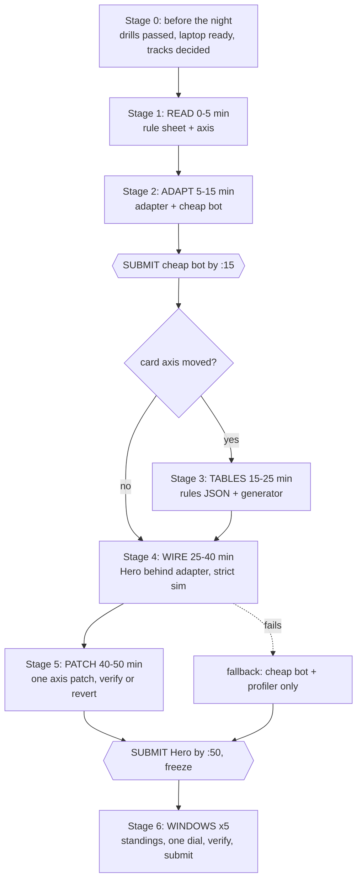

# PLAYBOOK: the hour, stage by stage

This is the single guide for event night. The human reads it; the agent is fed it as its first
message together with `docs/prompts/00-briefing.md`. It is variant-agnostic by construction: every
hold'em twist moves one of four axes, and the stages below are the same no matter which axis moved.
Only Stage 5 branches.

Everything here was either measured in a drill (`docs/drills/`) or is marked **unverified**.
Revise it after every drill. Never add a stage; sharpen the one that failed.

---

## 0. The whole plan on one screen

**What wins.** Eight-bot tables, points by finish, averaged over 10,000 tables, six tournaments
weighted 1 to 6. The field is one-hour student bots. The bot that wins (a) never crashes or times
out, (b) survives the early game, (c) plays the short-stack phase correctly with ICM, (d) attacks
seats that are dead or timing out, (e) is submitted in every window. Deep postflop skill is worth
almost nothing; blinds reach 200/400 by hand 175 and every table ends in push/fold.

**What the hour is.** Translation and verification. Zero research, zero tuning. The prompts are
pre-written; the code is pre-designed; the hour wires it to an interface we have never seen and
applies one patch for the axis the variant moved.

**The four axes.** Hand-strength ordering · Information · Payoff · Betting structure. Stage 1
names which one moved; Stage 5 applies that axis's patch. Nothing else in the hour depends on it.

**The clock.** T1 is worth 4.8% of the score. T5 and T6 together are 52%. The hour buys a seat at
the table; the five 20-minute windows after it decide the result. Be conservative early.

---

## 1. Roles

Two people. If solo, you are the Driver and the Verifier checklist is on paper.

| Role | Owns | Never does |
|---|---|---|
| **Driver** | the agent session, pasting prompts in order, the submission portal | reads rules in depth, debates strategy |
| **Verifier** | the rules text, the rule sheet, the clock, the pass checks, `NIGHT.md`, the frozen hashes | touches the agent session |

The Verifier calls every stage transition out loud with the minute. The Driver does not move to the
next prompt until the Verifier says the pass check is met or the time box has expired.

---

## 2. Stage 0: before the night

Done at home. Not optional; each item has sunk a drill or will.

**Decided**
- [ ] Track A or Track B (section 8). Default: **Track B** unless the organizers confirmed in writing
      that pre-written code and tables are allowed. The email is in section 10.
- [ ] Tool: Claude Code with Opus 5.5 in fast mode if any tool is allowed; otherwise Codex with Astra.
      Effort: extra high for Stage 1 and Stage 5, medium or high for Stages 2 to 4. **Unverified:**
      measure the effort cost in the next drill.
- [ ] Who sits at the table and which regional. Eligibility is students and the classes of 2025 and
      2026 only.

**Rehearsed**
- [ ] One full drill per fake kit (A, B, C, D) with the tool you will use, on the laptop you will bring.
      Targets from drills 1 and 2: legal submission by minute 3, Hero wired by minute 10.
- [ ] One Track B drill from a blank directory. **Unverified:** no Track B drill has run yet; the
      15-minute target for the cheap bot is a design estimate.
- [ ] You can type the crash-proof wrapper from memory in five minutes.

**Prepared**
- [ ] Laptop plugged in, performance power mode, sleep and lock off, notifications off, phone hotspot.
- [ ] Repo pulled, `pytest -q` green, hash recorded. `tables/` regenerated this week.
- [ ] Known-good Hero number written down: `python -m hyperion.sim --tables 300 --seed 11 --mode strict
      --field realistic`. This is the number to beat tonight.
- [ ] Timer alarms: :12, :28, :40, :50, :55.
- [ ] Printed: this playbook's section 0 and the stage table in section 3, the four kit rubrics
      (`hyperion/drills/fakekits/*/RUBRIC.md`), the organizers' email reply if any.

---

## 3. The stages

| # | Stage | Clock | Driver pastes | Effort | Pass check | If it fails |
|---|---|---|---|---|---|---|
| 1 | READ | 0:00–0:05 | `00-briefing` then `01-rule-sheet` with the rules and kit path | xhigh | Rule sheet filled, axis named, assumption diff listed | Verifier answers the agent's questions from the rules text; no code until the sheet exists |
| 2 | ADAPT | 0:05–0:15 | `02-adapter-and-cheap-bot` | medium | Kit simulator 50 hands: 0 exceptions, 0 illegal, bot folds/calls/raises at least once; zip hashed | At 0:12 with no clean adapter: submit the kit's own example bot. Never pass 0:15 without a submission |
| 3 | TABLES | 0:15–0:25, only if the strength or information axis moved | `03-tables` | medium | Generator finished, fingerprint matches, one remapped decision printed sane | Keep old tables; note which Stage 5 patch compensates |
| 4 | WIRE | 0:25–0:40 | `04-wire-hero` | high | Kit sim 100 hands clean; our strict sim 300 tables: 0 exc, 0 illegal, p99 < 300 µs, timeouts < 0.3% of decisions, Hero ≥ tag − CI | Fallback: cheap bot + profiler dead-seat and station flags only. Verify again. |
| 5 | PATCH | 0:40–0:50 | `05-variant-patch`, the section for the named axis | xhigh | Same strict sim; points did not drop beyond CI; errors still zero | Revert. Ship without the patch. |
| — | SUBMIT | 0:50 | — | — | Portal confirms; sha256 in `NIGHT.md`; copy to `frozen/T1` | Resubmit the Stage 2 cheap bot |
| 6 | WINDOWS | after T1, ×5 | `06-windows` with standings pasted | high | One dial, verified in strict sim, submitted by minute 15 of the window | Keep the frozen bot. Submit nothing. |

### Stage 1: READ (0:00–0:05)

The Verifier reads the rules once, slowly, while the Driver pastes the briefing and gets the agent's
one-paragraph restatement. Then the rule sheet prompt with the rules text verbatim and the kit path.

The sheet has four parts and all four matter: the rules (cards, board, ranking, betting, schedule,
scoring), the interface (class, method, state fields, action format, time limit, lifecycle), the
**axis classification**, and the **assumption diff** against our defaults. The axis drives Stage 5;
the diff drives Stage 3. Drills 1 and 2 both produced the sheet by minute 2.

The most dangerous thing is the one the agent names at the end of the sheet. Read it.

### Stage 2: ADAPT (0:05–0:15)

The only code that cannot be pre-written. One `Adapter` subclass translating kit state to our
`Observation` and our `Action` back, wrapped in whatever the kit wants, with the cheap bot behind
it. The gotchas, in the order they have bitten: card encoding (`T` vs `10`, suit case, dicts vs
strings vs ints), street as index vs board length, whether pot includes this street's bets, raise
as total vs increment, legal-action names, how "check" is spelled, seat numbering, where the button
is, and whether a per-table init exists for warm-up. The kit rubrics list these per fake kit.

Submit at 0:12 if the adapter is clean, 0:15 at the latest no matter what. The cheap bot on the
board is the single most valuable thing in the hour: from that minute we cannot score zero.

### Stage 3: TABLES (0:15–0:25, conditional)

Only when the rule sheet says the strength or information axis moved. One rules JSON, one command.
Default generation is about 50 seconds on 7 cores; a 3-hole-card variant about 3 minutes. The
generator re-solves push/fold from the new matrix and the loader verifies the fingerprint, which
closed the bug drill 1 found. Then one remapped decision printed, because drill 1 also found that
Hero can load the right tables and still hand strategy the wrong cards.

If the axis did not move, skip to Stage 4 and say so in `NIGHT.md`. Drill 2 skipped correctly.

### Stage 4: WIRE (0:25–0:40)

Swap the cheap bot for `make_bot()`. Verify in this order: kit simulator, our strict sim on the
realistic field, duplicate-dealt rotation, latency under load, import time from a fresh process.
The strict sim is the gate: zero exceptions, zero illegal actions, latency inside budget, and Hero
not worse than the tight chart bot. If the engine cannot represent the variant, run the standard
game, caption every result "variant minus X", and let Stage 5 carry the difference.

The fallback is not "fix Hero." It is the cheap bot plus the profiler's dead-seat and station flags,
which is most of Hero's edge against this field at a fraction of the surface area.

### Stage 5: PATCH (0:40–0:50)

One axis, one patch, as `Config` overrides or a single small function. The axis sections in
`05-variant-patch.md` are the pre-reasoned fixes. Re-run the strict sim; keep only if points did not
drop beyond the confidence interval and errors stayed at zero. Drill 2's lesson: when the sim is
blind to what the patch compensates for (it could not play antes), the prompt's own revert rule
fires and the patch is dropped. That is correct behaviour, not a failure. Ship unpatched rather than
ship unverified.

### Submit and freeze (0:50)

Submit Hero. Hash it. `cp` it to `frozen/T1`. Write the hash and minute in `NIGHT.md`. From 0:55 to
1:00 touch nothing; re-read the submission rules once: under 100 MB, no network, entry point named
exactly as the kit wants.

### Stage 6: WINDOWS (after T1, five times)

Each window is 20 minutes and the same loop. Minutes 0 to 5: read standings; our rank, our mean,
the spread, and if the kit shows per-table results, ten tables we finished last in. Minutes 5 to
12: one dial from the signal table in `06-windows.md`, verified in the strict sim against the
previous number. Minutes 12 to 15: freeze then submit, or submit nothing. Minutes 15 to 20: three
lines in `NIGHT.md`.

Hard rules: one change per window; no new modules; nothing unverified; timeouts or errors in any log
override everything (switch to `Config.cheap=True`, verify, submit). Tournaments 5 and 6 are 52% of
the score: the bot that plays T6 should be a bot that has already played T4 or T5 clean.

---

## 4. The axis table (what Stage 5 does)

| Axis | Examples | What breaks | Patch |
|---|---|---|---|
| **Strength ordering** | permuted ranks, short deck, reversed rankings | every table; evaluator rank map | regenerate tables from the rules JSON; strategy untouched; short deck shifts flush/straight thresholds |
| **Information** | 3 hole cards with discard, swaps, exposed card, two boards | preflop class scheme; value of a made hand before the last change | best-two-card class plus a bonus; raise value thresholds before the last swap; split-pot sizing |
| **Payoff** | bounties, auctions, top-heavy points | what a chip is worth | add expected side payoff to the pot in shove/call EV; paste the real payouts into `Rules.payouts` |
| **Betting structure** | pot limit, fixed sizes, antes, fast schedule | legal action set; open sizes; push depth | adapter clamps; sizes in `Config`; antes loosen opens one step and push depth 2 bb |

A twist that is not poker underneath (hands ranked by card sum, no community cards) is off this
table. Then the plan is the Track B cheap bot with hand-written rules and the profiler. Estimated
probability: a few percent; the MIT archive never did it in seven years.

---

## 5. The signal table (what a window does)

| Standings say | Likely cause | Dial |
|---|---|---|
| Many firsts, many 7th/8th | busting early, too willing to gamble | raise ICM premium, raise all-in value tier, stop light 3-bets |
| Mid-table, few firsts, few lasts | too passive for this field | lower steal threshold on button/cutoff, more c-bets vs folders |
| Many near-zero scorers in the field | lots of dead/timing-out bots | dead-seat detection from 5 to 3 observations, wider shoves into flagged seats |
| Top scores bunched, field tight | strong field | tighten opens, keep premium high, faster profiler weights |
| Any timeout or error in our log | we are the problem | `Config.cheap=True`, verify, submit, then investigate |

---

## 6. Evidence and open items

**Measured**
- Drill 1 (kit B, permuted ranks): legal submission minute 2, Hero clean minute 10, Hero first at
  the end. Found the board-remap bug and the stale push/fold cache. 15 prompt defects fixed.
- Drill 2 (kit C, top-heavy payouts + fast schedule + unsupported ante): legal submission minute 3,
  Hero clean minute 4, Hero first. Correctly skipped Stage 3. Correctly reverted an unverifiable patch.
- Hero vs the realistic student field before tuning: third behind the tight chart bot and the
  push/fold bot; busts from short shoves into loose callers. Tuning in progress; see `docs/decisions.md`.

**Unverified**
- Track B timings. No blank-directory drill has run.
- Effort-setting cost per stage.
- Whether tools other than Astra and Codex are permitted in the room.
- Whether pre-written code and tables are permitted at all.
- The real Agent interface, payout table, blind schedule and sandbox CPU.
- Score reproducibility in strict mode on a loaded laptop is about ±0.2 points at 300 tables; a
  Stage 5 verdict inside that band is a coin flip. Use `--mode measure` for the comparison and
  strict mode only for the error and latency counts.

---

## 7. Hard rules

1. A submission exists by 0:15. Nothing else matters until it does.
2. Strategy code never imports the kit. One adapter.
3. Every change is verified by a command whose output the Verifier reads. No change is kept on the
   agent's word.
4. One axis patch in the hour. One dial per window.
5. The frozen bot is always one command from being resubmitted.
6. When the sim cannot see what a patch does, the patch does not ship.
7. Timeouts or errors in our own log override every other priority.
8. Nobody researches, tunes, or refactors after 6 PM.

---

## 8. Track A and Track B

**Track A** (pre-written code confirmed allowed): the agent works in this repo. Stages 2 to 4 are an
adapter, a generator run and a sim run. Drilled twice.

**Track B** (default): blank directory; the agent rebuilds from `docs/prompts/track-b-from-scratch.md`,
which is the compressed specification of this repo: cheap bot by minute 15, evaluator and profiler by
30, equity table and ICM gate by 45, axis patch if time remains. The prompt pack is the carried-in
knowledge; the code is written in the hour by an allowed tool. Not yet drilled.

The track is decided in Stage 0, never on the night.

---

## 9. Revision log

| Date | Change | Source |
|---|---|---|
| 2026-10-31 | v1, consolidating `docs/night-of.md`, `docs/prompts/README.md`, drills 1 and 2 | this session |

---

## 10. The email (send before the event)

To pokerbot@sequoiacap.com, subject "Four questions before the regional":

1. May teams bring code or precomputed lookup tables written before the event, or must everything in
   the submission be written during the 60-minute build?
2. Which Python version and which packages beyond the standard library are importable in the sandbox?
3. Will the Agent interface or starter kit be shared before the event, or only at the start of the
   build phase? Is there a per-table initialization call outside the 1 ms budget?
4. May teams use AI coding tools other than Astra and Codex during the build?
