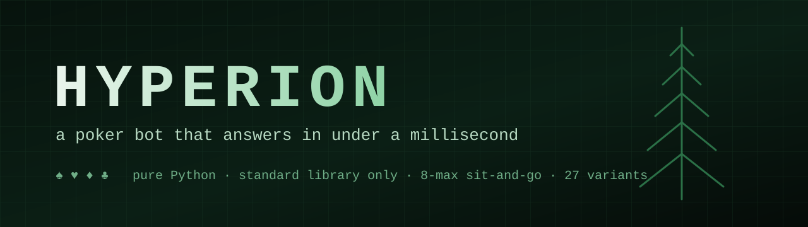
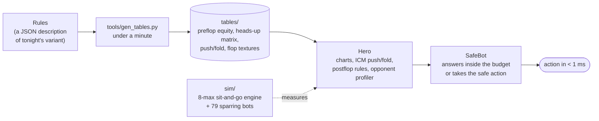

<p align="center">
  
</p>

<p align="center">
  
  
  
  
  
  
</p>

<p align="center">
  <b>A millisecond-budget poker engine, bot sandbox and strategy tables, in pure Python.</b><br>
  Named for the tallest living redwood.
</p>

---

## Why this exists

In October 2026, Sequoia, Citadel Securities and OpenAI announced
[**No Limit: A Bot Building Tournament**](https://pokerbot.sequoiacap.com/). The format is a great puzzle:

- teams of one or two get **60 minutes** to build a Python poker bot from scratch;
- the poker **variant is secret** until the clock starts;
- bots then play six scored tournaments of **10,000 eight-bot sit-and-gos** each;
- every decision must come back within **one millisecond**, or the bot folds
  ([official rules](https://pokerbot.sequoiacap.com/rules.html)).

I didn't have the opportunity to fly out and compete, so I built this instead, for fun: the engine, the tables and
the practice room I would have wanted to walk in with. Six days, 848 commits.

It is not an entry and it never played in the tournament. It is what the problem looks like when you take
"one millisecond, unknown rules, one hour" seriously.

## The idea

A millisecond in Python rules out solving anything at the table. So nothing is solved at the table.

Everything expensive happens ahead of time and is written to tables. At decision time the bot does lookups, a little
arithmetic, and returns. When the variant changes, a short `Rules` description regenerates the tables in under a
minute, which fits inside the build hour.



## What's inside

| Piece | What it does |
|---|---|
| **Evaluator** | Ranks any 5-to-8-card hand with one dictionary lookup, in a few microseconds. |
| **Exact ICM** | Turns chip stacks into tournament equity, so push/fold decisions account for the payout structure. |
| **Table generator** | Rebuilds every strategy table from a `Rules` JSON for a new variant, in under a minute. |
| **Hero** | The player: preflop charts, ICM-gated push/fold, postflop rules, and an opponent profiler. |
| **SafeBot** | A wrapper that guarantees an answer inside the time budget, falling back to the safe action. |
| **Simulator** | An 8-max sit-and-go engine with the blind schedule, ICM scoring and strict 1 ms enforcement. |
| **Bestiary** | 79 registered opponents to measure against, from calling stations to purpose-built exploiters. |
| **Drills** | Fake starter kits and a timed 60-minute drill, to rehearse the build hour end to end. |

<details>
<summary><b>The 27-variant catalog</b> (what "the rules are secret" might mean)</summary>

<br>

| Axis | Variants |
|---|---|
| Hand ranking | permuted ranks, short deck, lowball, wild deuces, flush over full house |
| Information | three hole cards (toss one, blind discard, keep all), four-card Omaha, swap hold'em, swap one on the turn, exposed card, two boards, bonus card, auction, deal five keep two |
| Payoff | bounty, knockout bounty, top-heavy points, hi-lo split, tranche hold'em |
| Betting | pot limit, antes from level 3, fixed raise, fast schedule, straddle, river of blood |

```
python -m hyperion.drills.variants --list
```

Every entry is playable in the simulator. The list says which ones regenerate tables for the variant, which reuse the
default tables, and which the tables do not support.

</details>

## Run it

```bash
uv venv .venv && uv pip install -e ".[dev]"

# the test suite
.venv/bin/python -m pytest -q

# 1,000 tables of 8-max, strict 1 ms enforcement, Hero against a mixed room
.venv/bin/python -m hyperion.sim --tables 1000 --seed 7 --mode strict \
    --bots hero,tag,nit,naive,station,maniac,random,allin

# rehearse the build hour on a surprise variant
.venv/bin/python -m hyperion.drills.run --variant permuted_ranks --kit b --seed 1
```

The decision path uses the standard library only. `pytest` and `pytest-benchmark` are the only development
dependencies.

## How it did

Measured in its own simulator, against its own opponent pool, on held-out seeds. These are practice-room numbers,
not tournament results.

- Against every held-out "judge" field, the final composite bot finished **first**.
- Against the single strongest room it was **second or third of eight**, behind an older rival bot.
- Under strict timing through a starter kit, a governor that watches the whole timed call cut timeouts against the
  elite room from about 15% to about 2%.

The full working record is in the repo: [`docs/drills/goal-leaderboard.md`](docs/drills/goal-leaderboard.md) for the
running leaderboard and [`docs/decisions.md`](docs/decisions.md) for every call made along the way.

## Layout

| Path | What |
|---|---|
| `hyperion/core/` | cards, the 5-to-8-card evaluator, equity generators, exact ICM |
| `hyperion/strategy/` | SafeBot, opponent profiler, preflop charts, push/fold with the ICM gate, postflop rules, `Hero` |
| `hyperion/sim/` | the sit-and-go engine, the bestiary, a runner with confidence intervals and latency stats |
| `hyperion/drills/` | fake starter kits, the adapter pattern, the variant catalog, the timed drill |
| `tools/gen_tables.py` | regenerates every table from a `Rules` JSON |
| `tables/` | generated JSON: preflop equity against 1 to 7 opponents, a 169 x 169 heads-up matrix, push/fold, flop textures |
| `docs/` | the design spec, the decision log, research notes and the drill reports |

## What it does not do

Full-game CFR, neural networks or real-time search. The millisecond and the secret variant rule them out.

It also does not handle boards above eight total cards, a real auction (the catalog's `bonus_card` posts a fixed
price), or private per-seat extras (bounties are public in the simulator).

---

<p align="center">
  Built by <a href="https://github.com/hyattc1">Connor Hyatt</a> &#183; not affiliated with Sequoia, Citadel Securities or OpenAI
</p>
